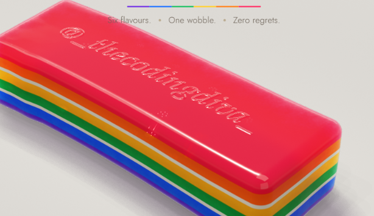

<div align="center">

# @vickroxstudio

### A little jelly. A lot of wobble.

An interactive, six-layer rainbow jelly experiment made with WebGPU — stretch it, watch it wobble, and slice it into pieces.

<p>
  <a href="https://github.com/vignesh90431-boop/jelly">
    
  </a>
  
  
</p>



</div>

## The experiment

A glossy, layered jelly bar rendered in the browser. Drag it to pull and wobble the gel, or switch to the knife and draw a cut. Its custom WebGPU shaders create the translucent material, while a tetrahedral simulation drives the deformation.

## What you can do

- **Stretch and wobble** the jelly by dragging it around the canvas.
- **Slice it** with the knife tool and watch the pieces move.
- **Explore six color layers** and their soft, milky seams.
- **Adjust the experiment** with the built-in controls, readouts, and sound.
- **Inspect the details** in the “Inside the experiment” section of the page.

## Run it locally

This is a self-contained HTML project; no package installation or build step is needed. WebGPU requires a compatible browser and a secure context, so serve the page from localhost instead of opening the file directly.

```bash
py -m http.server 8000
```

Then open [http://localhost:8000](http://localhost:8000) in a recent WebGPU-capable browser, such as Chrome or Edge.

## Project files

```text
.
├── assets/
│   └── preview.png
├── index.html
└── README.md
```

The HTML file contains the page markup, styles, JavaScript simulation, and WGSL shader code.

---

<div align="center">
  <sub>Made with curiosity, color, and a little bit of wobble — <strong>@vickroxstudio</strong></sub>
</div>
